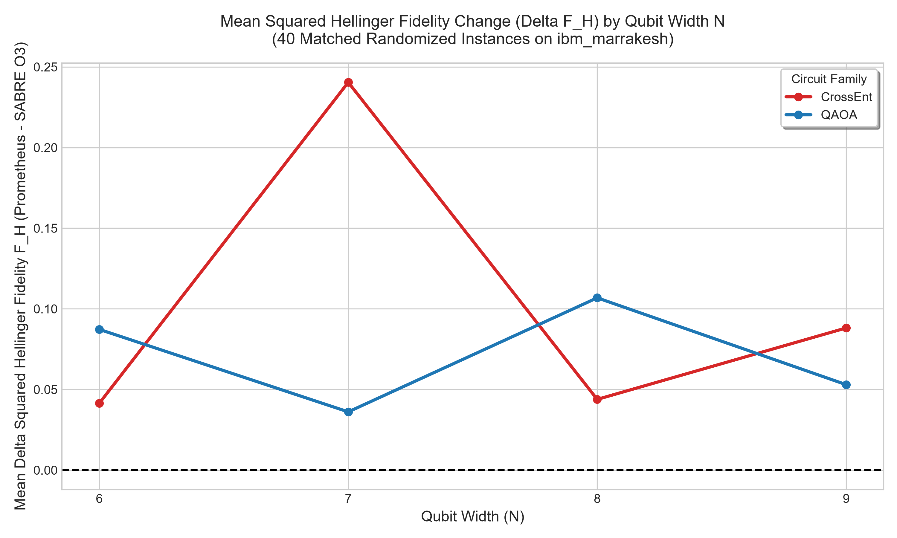
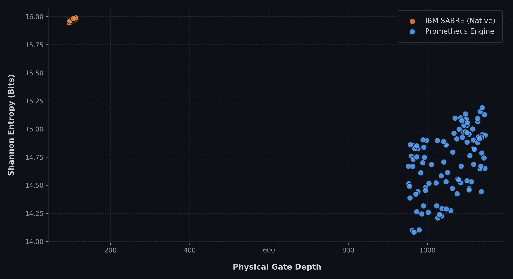

# PROMETHEUS // Quantum Execution Telemetry

Mechanistic operating-envelope experiments (01-05) investigating how physical routing overhead, regional coupler error heterogeneity, and target-QPU selection interact on 156-qubit IBM Heron processors.

**Dataset Scope:** 14 IBM Quantum jobs (774 physical PUBs, 4,125,440 physical shots across all 14 archived `job-*-result.json` measurement arrays; 417 normalized circuit rows and 1,671,168 shots in [`MASTER_RESULTS.csv`](MASTER_RESULTS.csv) for Experiments 01-03), 73 logical OpenQASM circuits, SHA-256 integrity manifests ([`IBM_JOB_EVIDENCE_INDEX.csv`](IBM_JOB_EVIDENCE_INDEX.csv)), and standalone offline verifiers.

---

## 1. Executive Summary of Mechanistic Experiments (01 - 05)

> [!NOTE]
> **Metric & Direction Conventions:**
> - **Squared Hellinger Fidelity (F_H = F_B², ↑ higher is better):** In this repository (`hellinger_fidelity` in [`MASTER_RESULTS.csv`](MASTER_RESULTS.csv) and `02`/`03` `summary.csv`), fidelity is defined as F_H(P_ideal, P_meas) = (Σ_x √(P_ideal(x) · P_meas(x)))² = F_B² (where F_B = √(F_H) is the unsquared Bhattacharyya overlap). Both evaluate computational-basis measurement distributions from shot histograms and are distinct from 4ⁿ state tomography.
> - **Total Variation Distance (TVD, ↓ lower is better):** 0.5 · Σ_x |P_ideal(x) - P_meas(x)|.
> - **Shannon Entropy (H, context-dependent):** -Σ_x P_meas(x) log₂ P_meas(x) in bits (measures distributional concentration/spread rather than agreement with P_ideal).

| Experiment | Target QPU(s) & IBM Job ID(s) | Scale & Sample Size | Primary Observable & Direction | Key Empirical Finding |
| :--- | :--- | :--- | :--- | :--- |
| **[`01 - Distributional Concentration`](01-distributional-concentration/)** | `ibm_kingston`, `ibm_fez` (8 jobs in [`IBM_JOB_EVIDENCE_INDEX.csv`](IBM_JOB_EVIDENCE_INDEX.csv)) | 5Q-8Q, up to 100,000 shots/circuit | Shannon Entropy H (bits), Top-5 Mass (↑), KL Divergence (↓) | On 8Q QFT (100k shots), a 7.0x deeper / 9.6x higher-2Q physical routing path reduced output entropy (**6.6045** vs. 7.9554 bits) while increasing D_KL (1.6370 vs. **0.0453**), proving **distributional concentration and distributional agreement are separable variables**. |
| **[`02 - Randomized Instance Robustness`](02-randomized-instance-robustness/)** | `ibm_marrakesh` (`job-da1httsdedkc73er2k70`) | 40 matched randomized QAOA & CrossEnt pairs (6Q-9Q, 120 PUBs) | Squared Hellinger Fidelity F_H (↑), TVD (↓) | Prometheus achieved higher Squared Hellinger Fidelity F_H than **SABRE O3** in **30/40 (75.0%)** randomized instances (**4/5** on 9Q CrossEnt, e.g., **0.7450** vs. 0.6438) despite higher routed 2Q gate counts (10/40 cases entered the routing-penalty regime). |
| **[`03 - Micro-Gradient Scaling`](03-micro-gradient-scaling/)** | `ibm_marrakesh` (`job-da1do46g52gs73clh7c0`) | 3Q-10Q across QFT, QAOA, CrossEnt, GHZ (96 PUBs, 960,000 shots) | Squared Hellinger Fidelity F_H (↑), TVD (↓) | Mapped the transition boundary between **topological advantage** (QFT-9 Δ F_H = **+0.1197**, QAOA-6 **+0.1627**, QAOA-9 **+0.1461**) and **routing-penalty dominance** (QAOA-10 -0.0591, QFT-10 -0.0306). |
| **[`04 - Ground-State Avoidance`](04-topological-mapping-ground-state-avoidance/)** | `ibm_kingston` (`job-d971l1gtcv6s73dkc89g`) | 13Q Cross-Entanglement (80,000 shots/PUB) | All-Zero (`0...0`) Pooling (↓), Shannon Entropy H (↑) | Accepting a deeper cleaner path (346 vs. 42 depth) reduced undesirable all-zero ground-state pooling by **-62.9%** (**206** vs. 555 shots) and preserved distributed state entropy (**12.2850** vs. 11.0683 bits). |
| **[`05 - Three-QPU Mechanistic Sweep`](05-3qpu-mechanistic-sweep/)** | `ibm_fez`, `ibm_kingston`, `ibm_marrakesh` (`da2hqsc...`, `da2i2hb...`, `da2ibse...`) | 540 physical circuits (180 PUBs × 3 QPUs × 2,048 shots = 1,105,920 shots) | QAOA MaxCut Value ⟨ C ⟩ (↑), QFT Top-1 Prob P_top1 (↑) | Demonstrated the **Median Error Paradox**: detour routing won **67%** of conditional N ∈ {6,7} QAOA comparisons on spatially heterogeneous `ibm_marrakesh`, but was disadvantageous on spatially uniform `ibm_fez` and `ibm_kingston` and at N=8. |



*Figure 1: Randomized Instance Scaling Trends (N = 6 to N = 9 QAOA MaxCut and Cross-Entanglement; 40 matched randomized problem instances / 120 compiled PUBs executed in a single packed `SamplerV2` job `job-da1httsdedkc73er2k70` on `ibm_marrakesh`; source: [`02-randomized-instance-robustness/data/summary.csv`](02-randomized-instance-robustness/data/summary.csv)).*



*Figure 2: Physical Circuit Depth (↓) vs. Measured Output Shannon Entropy H (bits) for the 100 paired hardware executions (200 circuit rows: n = 100 SABRE O3 with mean depth 104.5 (mean) and mean H = 15.9744 bits (mean) vs. n = 100 Prometheus with mean depth 1,054.9 (mean) and mean H = 14.7082 bits (mean)) plotted from [`01-distributional-concentration/data/prometheus_telemetry.csv`](01-distributional-concentration/data/prometheus_telemetry.csv). (The complete Experiment 01 inventory in [`MASTER_RESULTS.csv`](MASTER_RESULTS.csv) contains 216 rows: these 200 paired scatter-telemetry rows, 6 100,000-shot benchmark rows from `benchmark_heron_100k.csv`, and 10 4,000-shot baseline rows from `benchmark_heron_4k.csv`.)*

---

## 2. One-Line Local Verification ([`REPRODUCE.md`](REPRODUCE.md))

Every experiment includes a standalone Python verifier that unpacks the compressed Base64/zlib Qiskit `BitArray` tensors directly from the archived `job-*-result.json` payloads:

```bash
# Verify SHA-256 digests and byte lengths across all 14 archived IBM Quantum result payloads
python verify_sha256_evidence.py

# Run individual experiment verifiers
python 01-distributional-concentration/scripts/verify_distribution.py
python 01-distributional-concentration/scripts/local_telemetry_extractor.py
python 02-randomized-instance-robustness/verify_benchmark.py
python 03-micro-gradient-scaling/verify_benchmark.py
python 04-topological-mapping-ground-state-avoidance/verify_benchmark.py
python 05-3qpu-mechanistic-sweep/verify_benchmark.py
```

### Normalized `MASTER_RESULTS.csv` Schema (432 Rows)

`MASTER_RESULTS.csv` consolidates per-execution telemetry across Experiments 01, 02, and 03:
- **Identifiers:** `experiment`, `benchmark`, `compiler`, `backend`, `job_id`, `qubits`, `execution_id`, `execution_index`, `status`
- **Structural Metrics (↓):** `depth`, `two_qubit_depth`, `one_qubit_depth`, `gate_count`, `1q_gates`, `abstract_2q_operations`, `final_native_2q_operations`, `logical_depth`, `logical_gate_count`, `logical_1q_gates`, `logical_abstract_2q_gates`, `routing_induced_2q_overhead`, `routing_induced_swaps`, `total_2q_expansion`
- **Measured Observables:** `hellinger_fidelity` (F_H ↑), `hellinger_distance` (↓), `tvd` (↓), `jsd` (↓), `kl_divergence` (↓), `heavy_output_probability` (↑), `shannon_entropy` (bits), `renyi2_entropy` (bits), `min_entropy` (bits), `entropy_delta`, `algorithmic_success` (↑), `algorithmic_success_margin_95`, `bootstrap_uncertainty`

---

## 3. Scope & Interpretation Boundaries

The experiments in this repository do not claim universal compiler superiority, guaranteed fidelity improvement from adding routing operations, or a single physical variable that determines execution quality. Negative and mixed outcomes (such as the 10/40 routing-penalty cases in Experiment 02, the 10Q crossover in Experiment 03, and the homogeneous-QPU results in Experiment 05) are preserved in full because they define the empirical operating boundary of hardware-aware routing.

---

## 4. Prometheus Dynamics Public Repository Portfolio (9 repositories | 248 benchmark jobs | 5,110 physical circuits/PUBs | 13,264,640 physical shots)

**Portfolio Totals:** 9 Verified Repositories | 248 Completed Benchmark Jobs/Tasks (167 IBM Heron Jobs, 22 AWS Braket Tasks, 59 IQM Resonance Jobs) | 5,110 Physical Circuits/PUBs | 13,264,640 Physical Measurement Shots

Counts refer to completed public benchmark executions, excluding simulations, classical GPU runs, unrecovered queue dispatches, and two setup smoke tests. Shared datasets are counted once (`IBM-Heron-156Q-Benchmarks` includes the 4-job 144-circuit pre-committed suite, and `Hybrid-Quantum-HPC-Benchmarks` includes all 33 archived job ZIPs from `qpu-selection-execution-quality`).

| Repository | Scope & Empirical Dataset | Primary Verification Artifacts |
| :--- | :--- | :--- |
| **[`IQM-Resonance-Spatial-Multiplexing`](https://github.com/PrometheusDynamicsCanada/IQM-Resonance-Spatial-Multiplexing)** | **IQM Emerald (54Q) Dense-Circuit Optimization & Spatial Multiplexing:** 59 scored hardware jobs (1,479 physical circuits/PUBs, 1,935 workload evaluations, 1,135,616 physical shots): 19-job Dense-Circuit Optimization, Odd/Even Parity, & Matched-Placement Campaign (739 circuits, 756,736 shots, **+3.73%** vs. SABRE K8, **+7.57%** vs. Pure TKET K8, **16/16** matched-placement wins) + 40-job Spatial Multiplexing & Prospective Scheduler Campaign (740 PUBs, 1,196 evaluations, **3.30x** 4-Way throughput). | [`data/dense_campaign_stages2_3_4_results.json`](https://github.com/PrometheusDynamicsCanada/IQM-Resonance-Spatial-Multiplexing/blob/main/data/dense_campaign_stages2_3_4_results.json), [`data/stage2_emerald_replication_results.json`](https://github.com/PrometheusDynamicsCanada/IQM-Resonance-Spatial-Multiplexing/blob/main/data/stage2_emerald_replication_results.json), [`scripts/verify_iqm_resonance_ledger.py`](https://github.com/PrometheusDynamicsCanada/IQM-Resonance-Spatial-Multiplexing/blob/main/scripts/verify_iqm_resonance_ledger.py) |
| **[`Quantum-Execution-Manager-Spatial-Multiplexing`](https://github.com/PrometheusDynamicsCanada/Quantum-Execution-Manager-Spatial-Multiplexing)** | **IBM Heron 8-Way Spatial Multiplexing & Multi-Compiler Meta-Selection:** 19 completed hardware jobs (586 physical PUBs, 1,140 workload evaluations, 655,360 physical shots) across `ibm_fez`, `ibm_marrakesh`, and `ibm_kingston` (**2.85x** qualifying workloads per billed second, **-57.1%** billed time, and SABRE/TKET/Prometheus interoperability). | [`data/campaign3_compiler_interoperability_results.json`](https://github.com/PrometheusDynamicsCanada/Quantum-Execution-Manager-Spatial-Multiplexing/blob/main/data/campaign3_compiler_interoperability_results.json), [`scripts/verify_spatial_multiplexing_campaigns.py`](https://github.com/PrometheusDynamicsCanada/Quantum-Execution-Manager-Spatial-Multiplexing/blob/main/scripts/verify_spatial_multiplexing_campaigns.py) |
| **[`IBM-Heron-Extended-Validation-1023-Circuits`](https://github.com/PrometheusDynamicsCanada/IBM-Heron-Extended-Validation-1023-Circuits)** | **4-Pillar Extended IBM Heron r2 Validation (1,023 Circuits):** 17 batch jobs (1,023 physical circuits, 1,047,552 physical shots) across `ibm_marrakesh`, `ibm_fez`, and `ibm_kingston` (**+3.27%** mean F_B vs. SABRE O3 in Pillar 1A, **+6.67%** F_H with QPU dispatch, and 8Q-101Q Clifford mirror scaling). | [`ALL_1023_CIRCUITS_RESULTS.csv`](https://github.com/PrometheusDynamicsCanada/IBM-Heron-Extended-Validation-1023-Circuits/blob/main/ALL_1023_CIRCUITS_RESULTS.csv), [`scripts/verify_campaign.py`](https://github.com/PrometheusDynamicsCanada/IBM-Heron-Extended-Validation-1023-Circuits/blob/main/scripts/verify_campaign.py) |
| **[`AWS-Braket-Multi-Window-Validation`](https://github.com/PrometheusDynamicsCanada/AWS-Braket-Multi-Window-Validation)** | **Rigetti Cepheus-1-108Q 3-Window Replication & Cross-Provider Comparison:** 10 AWS Braket `ProgramSet` tasks (450 physical circuits, 460,800 physical shots) across 3 calibration windows (**+3.91%** vs. SABRE O3, p_Holm = 0.0112; **+9.03%** vs. TKET, p_Holm = 0.000641). | [`data/ALL_450_BRAKET_CIRCUITS_RESULTS.csv`](https://github.com/PrometheusDynamicsCanada/AWS-Braket-Multi-Window-Validation/blob/main/data/ALL_450_BRAKET_CIRCUITS_RESULTS.csv), [`scripts/verify_braket_campaign.py`](https://github.com/PrometheusDynamicsCanada/AWS-Braket-Multi-Window-Validation/blob/main/scripts/verify_braket_campaign.py) |
| **[`IBM-Heron-156Q-Benchmarks`](https://github.com/PrometheusDynamicsCanada/IBM-Heron-156Q-Benchmarks)** | **156Q Heron r2 Scaling & Pre-Committed Suite:** 10 packed `SamplerV2` batch jobs (441 physical circuits, 755,712 shots) across `ibm_fez`, `ibm_marrakesh`, and `ibm_kingston` covering 3Q-13Q odd/even parity scaling, a 15-algorithm matrix at 9Q (297 circuits), and the 144-execution pre-committed validation suite (4 jobs). | [`data/heron_156q_99tournaments_297circuits.csv`](https://github.com/PrometheusDynamicsCanada/IBM-Heron-156Q-Benchmarks/blob/main/data/heron_156q_99tournaments_297circuits.csv), [`validation_suite_144_executions/`](https://github.com/PrometheusDynamicsCanada/IBM-Heron-156Q-Benchmarks/tree/main/validation_suite_144_executions), `scripts/verify_ledger.py` |
| **[`Hybrid-Quantum-HPC-Benchmarks`](https://github.com/PrometheusDynamicsCanada/Hybrid-Quantum-HPC-Benchmarks)** | **Multi-Cloud QPU & Hybrid GPU Corpus:** 119 unique 3-way QPU jobs/tasks (357 physical circuits, 5,084,160 shots: 107 IBM Heron jobs / 321 circuits / 4,964,352 shots + 12 AWS Braket `ProgramSet` tasks / 36 circuits / 119,808 shots), plus the shared 144-execution pre-committed suite and 150 NVIDIA H100 (`VeloxQH100_1`) QUBO runs (4 to 1,029 variables). | [`aws_braket_qpu_12_jobs_ledger.json`](https://github.com/PrometheusDynamicsCanada/Hybrid-Quantum-HPC-Benchmarks/blob/main/aws_braket_qpu_12_jobs_ledger.json), [`ibm_heron_156q_verified_benchmarks.json`](https://github.com/PrometheusDynamicsCanada/Hybrid-Quantum-HPC-Benchmarks/blob/main/ibm_heron_156q_verified_benchmarks.json), [`validation_suite_144_executions/`](https://github.com/PrometheusDynamicsCanada/Hybrid-Quantum-HPC-Benchmarks/tree/main/validation_suite_144_executions), `verify_corpus_and_schedules.py` |
| **[`qpu-selection-execution-quality`](https://github.com/PrometheusDynamicsCanada/qpu-selection-execution-quality)** | **Cryptographic Provenance & Cross-QPU Arbitration:** 33 archived IBM Quantum job ZIP bundles (99 physical circuits, 1,622,016 shots across 16Q-23Q in `Fez/`, `Kingston/`, `Marrakesh/`, and 20Q-22Q broadcast runs in `Fez_Marrakesh_Kingston/`, already counted in the 107-job historical IBM corpus) plus the shared 4-job 144-circuit pre-committed suite. | [`EVIDENCE_INDEX.md`](https://github.com/PrometheusDynamicsCanada/qpu-selection-execution-quality/blob/main/EVIDENCE_INDEX.md), [`REPOSITORY_SHA256SUMS.txt`](https://github.com/PrometheusDynamicsCanada/qpu-selection-execution-quality/blob/main/REPOSITORY_SHA256SUMS.txt), `Fez_Marrakesh_Kingston/3_verify_and_view.py` |
| **[`prometheus-quantum-telemetry`](https://github.com/PrometheusDynamicsCanada/prometheus-quantum-telemetry)** | **Mechanistic Operating Envelope (01-05):** 14 IBM Heron jobs (774 physical PUBs, 4,125,440 physical shots across all 14 archived `job-*-result.json` measurement arrays; 417 normalized circuit rows in `MASTER_RESULTS.csv` for Experiments 01-03) covering distributional concentration (100k shots/circuit), 40 randomized matched pairs, 3Q-10Q scaling boundaries, 13Q ground-state avoidance, and a 540-PUB (1,105,920-shot) 3-QPU mechanistic sweep. | [`IBM_JOB_EVIDENCE_INDEX.csv`](https://github.com/PrometheusDynamicsCanada/prometheus-quantum-telemetry/blob/main/IBM_JOB_EVIDENCE_INDEX.csv), [`MASTER_RESULTS.csv`](https://github.com/PrometheusDynamicsCanada/prometheus-quantum-telemetry/blob/main/MASTER_RESULTS.csv), `verify_sha256_evidence.py` |
| **[`prometheus-execution-intelligence`](https://github.com/PrometheusDynamicsCanada/prometheus-execution-intelligence)** | **System Architecture & Consolidated Multi-Cloud Index:** Multi-compiler candidate evaluation (SABRE O3, TKET, Prometheus), multi-QPU dispatch workflow, and 18-screenshot Studio visual gallery indexing the 248 completed benchmark jobs/tasks across 6 QPUs. | [`ARCHITECTURE.md`](https://github.com/PrometheusDynamicsCanada/prometheus-execution-intelligence/blob/main/ARCHITECTURE.md), [`SCREENSHOT_GALLERY.md`](https://github.com/PrometheusDynamicsCanada/prometheus-execution-intelligence/blob/main/SCREENSHOT_GALLERY.md) |
