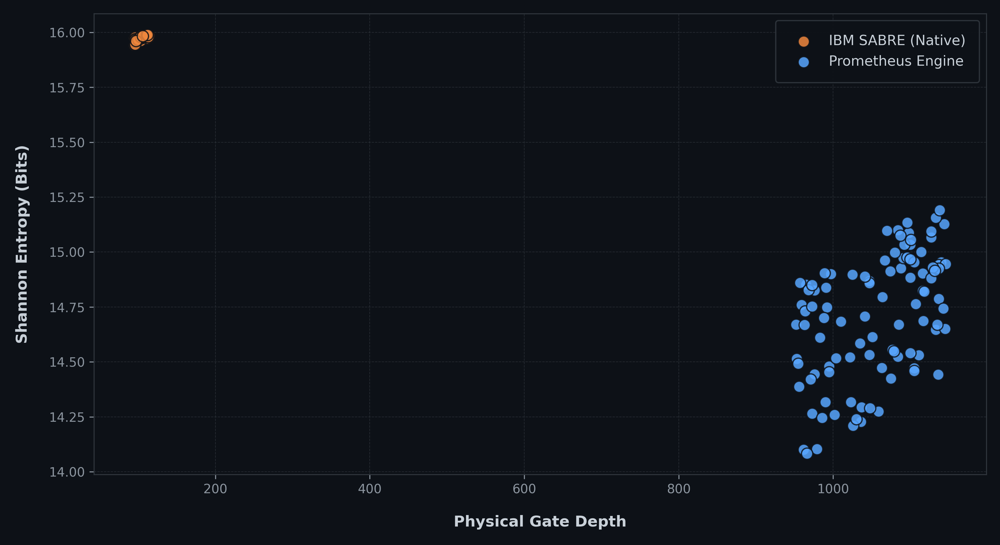

# PROMETHEUS // Quantum Execution Telemetry

**Mechanistic operating-envelope experiments (`01`-`05`) investigating how physical routing overhead, regional coupler error heterogeneity, and target-QPU selection interact on 156-qubit IBM Heron processors.**

This repository preserves the **logical OpenQASM circuits (`73` `.qasm` files)**, **14 raw returned IBM Quantum execution payloads (`job-*-result.json`)**, **SHA-256 integrity manifests (`IBM_JOB_EVIDENCE_INDEX.csv`)**, **normalized master telemetry (`MASTER_RESULTS.csv`)**, and **standalone Python verification scripts** across five controlled hardware experiments.

---

## Executive Summary of Mechanistic Experiments (`01` - `05`)

| Experiment | Target QPU(s) & IBM Job ID(s) | Scale & Sample Size | Primary Observable & Direction | Key Empirical Finding |
| :--- | :--- | :--- | :--- | :--- |
| **[`01 - Distributional Concentration`](01-distributional-concentration/)** | `ibm_kingston`, `ibm_fez` (`8` jobs in `IBM_JOB_EVIDENCE_INDEX.csv`) | `5Q`-`8Q`, up to `100,000` shots/circuit | Shannon Entropy $H$ (bits), Top-5 Mass (↑), KL Divergence (↓) | On `8Q QFT` (`100k` shots), a `7.0x` deeper / `9.6x` higher-2Q physical routing path reduced output entropy (`6.6045` vs. `7.9554` bits) while increasing $D_{\text{KL}}$ (`1.6370` vs. `0.0453`), proving **distributional concentration and distributional agreement are separable variables**. |
| **[`02 - Randomized Instance Robustness`](02-randomized-instance-robustness/)** | `ibm_marrakesh` (`job-da1httsdedkc73er2k70`) | `40` matched randomized QAOA & CrossEnt pairs (`6Q`-`9Q`, `120` PUBs) | Squared Hellinger Fidelity $F_H$ (↑), TVD (↓) | Prometheus achieved higher Squared Hellinger Fidelity $F_H$ than `SABRE O3` in **`30 / 40` (`75.0%`)** randomized instances (`4 / 5` on `9Q CrossEnt`, e.g., `0.7450` vs. `0.6438`) despite higher routed 2Q gate counts (`10 / 40` cases entered the routing-penalty regime). |
| **[`03 - Micro-Gradient Scaling`](03-micro-gradient-scaling/)** | `ibm_marrakesh` (`job-da1do46g52gs73clh7c0`) | `3Q`-`10Q` across QFT, QAOA, CrossEnt, GHZ (`96` PUBs, `960,000` shots) | Squared Hellinger Fidelity $F_H$ (↑), TVD (↓) | Mapped the transition boundary between **topological advantage** (`QFT-9` $\Delta F_H = +0.1197$, `QAOA-6` $+0.1627$, `QAOA-9` $+0.1461$) and **routing-penalty dominance** (`QAOA-10` $-0.0591$, `QFT-10` $-0.0306$). |
| **[`04 - Ground-State Avoidance`](04-topological-mapping-ground-state-avoidance/)** | `ibm_kingston` (`job-d971l1gtcv6s73dkc89g`) | `13Q` Cross-Entanglement (`80,000` shots/PUB) | All-Zero (`0...0`) Pooling (↓), Shannon Entropy $H$ (↑) | Accepting a deeper cleaner path (`346` vs. `42` depth) reduced undesirable all-zero ground-state pooling by **`-62.9%`** (`206` vs. `555` shots) and preserved distributed state entropy (`12.2850` vs. `11.0683` bits). |
| **[`05 - Three-QPU Mechanistic Sweep`](05-3qpu-mechanistic-sweep/)** | `ibm_fez`, `ibm_kingston`, `ibm_marrakesh` (`da2hqsc...`, `da2i2hb...`, `da2ibse...`) | `540` physical circuits (`180` PUBs $\times 3$ QPUs $\times 2,048$ shots = `1,105,920` shots) | QAOA MaxCut Value $\langle C \rangle$ (↑), QFT Top-1 Prob $P_{\text{top1}}$ (↑) | Demonstrated the **Median Error Paradox**: detour routing won **`67%`** of conditional $N \in \{6,7\}$ QAOA comparisons on spatially heterogeneous `ibm_marrakesh`, but was disadvantageous on spatially uniform `ibm_fez` and `ibm_kingston` and at $N=8$. |


*Figure 1: Randomized Instance Scaling Trends ($N = 6$ to $N = 9$ QAOA MaxCut and Cross-Entanglement; `40` matched randomized problem instances / `120` compiled PUBs executed in a single packed `SamplerV2` job `job-da1httsdedkc73er2k70` on `ibm_marrakesh`; source: [`02-randomized-instance-robustness/data/summary.csv`](02-randomized-instance-robustness/data/summary.csv)).*


*Figure 2: Physical Circuit Depth (↓) vs. Measured Output Shannon Entropy $H$ (bits) for the **`100` paired hardware executions (`200` circuit rows: $n = 100$ `SABRE O3` with mean depth `104.5` and mean $H = 15.9744$ bits vs. $n = 100$ `Prometheus` with mean depth `1,054.9` and mean $H = 14.7082$ bits)** plotted from [`01-distributional-concentration/data/prometheus_telemetry.csv`](01-distributional-concentration/data/prometheus_telemetry.csv). (The complete Experiment `01` inventory in [`MASTER_RESULTS.csv`](MASTER_RESULTS.csv) contains `216` rows: these `200` paired scatter-telemetry rows, `6` `100,000`-shot benchmark rows from `benchmark_heron_100k.csv`, and `10` `4,000`-shot baseline rows from `benchmark_heron_4k.csv`.)*

---

## Observable Definitions & Direction Conventions

- **Squared Hellinger Fidelity ($F_H$, ↑ higher is better):** In this repository (`hellinger_fidelity` in [`MASTER_RESULTS.csv`](MASTER_RESULTS.csv) and `02`/`03` `summary.csv`), fidelity is defined as the **Squared Hellinger Fidelity** between the noiseless Z-basis bitstring distribution $P_{\text{ideal}}(x)$ and the measured hardware distribution $P_{\text{meas}}(x)$ after inverse physical-to-logical qubit mapping:
  $$F_H(P_{\text{ideal}}, P_{\text{meas}}) = \left(\sum_{x \in \{0,1\}^n} \sqrt{P_{\text{ideal}}(x)\, P_{\text{meas}}(x)}\right)^2 = F_B^2$$
  *(Terminology comparison across repositories: [`validation_suite_144_executions/`](https://github.com/PrometheusDynamicsCanada/Hybrid-Quantum-HPC-Benchmarks/tree/main/validation_suite_144_executions) also uses Squared Hellinger Fidelity $F_H = F_B^2$, whereas the `fidelity` column in [`Hybrid-Quantum-HPC-Benchmarks`](https://github.com/PrometheusDynamicsCanada/Hybrid-Quantum-HPC-Benchmarks), [`IBM-Heron-156Q-Benchmarks`](https://github.com/PrometheusDynamicsCanada/IBM-Heron-156Q-Benchmarks), and [`qpu-selection-execution-quality`](https://github.com/PrometheusDynamicsCanada/qpu-selection-execution-quality) records the unsquared **Bhattacharyya overlap** $F_B = \sqrt{F_H}$. Both metrics evaluate Z-basis measurement distributions from shot histograms and are distinct from $4^n$ quantum state tomography.)*
- **Total Variation Distance ($\text{TVD}$, ↓ lower is better):** $\frac{1}{2} \sum_x |P_{\text{ideal}}(x) - P_{\text{meas}}(x)|$.
- **Shannon Entropy ($H$, context-dependent):** $-\sum_x P_{\text{meas}}(x) \log_2 P_{\text{meas}}(x)$ in bits (measures distributional concentration/spread rather than agreement with $P_{\text{ideal}}$).

---

## One-Line Local Verification (`REPRODUCE.md`)

See **[`REPRODUCE.md`](REPRODUCE.md)** for full instructions. Every experiment includes a standalone Python verifier that unpacks the compressed Base64/zlib Qiskit `BitArray` tensors directly from the archived `job-*-result.json` payloads:

```bash
# Verify SHA-256 digests and byte lengths across all 14 archived IBM Quantum result payloads
python verify_sha256_evidence.py

# Run individual experiment verifiers
python 01-distributional-concentration/scripts/verify_distribution.py
python 01-distributional-concentration/scripts/local_telemetry_extractor.py
python 02-randomized-instance-robustness/verify_benchmark.py
python 03-micro-gradient-scaling/verify_benchmark.py
python 04-topological-mapping-ground-state-avoidance/verify_benchmark.py
python 05-3qpu-mechanistic-sweep/verify_benchmark.py
```

### Normalized `MASTER_RESULTS.csv` Schema (`432` Rows)
`MASTER_RESULTS.csv` consolidates per-execution telemetry across Experiments `01`, `02`, and `03` using standardized `snake_case` columns:
- **Identifiers:** `experiment`, `benchmark`, `compiler`, `backend`, `job_id`, `qubits`, `execution_id`, `execution_index`, `status`
- **Structural Metrics:** `depth` (↓), `two_qubit_depth` (↓), `one_qubit_depth` (↓), `gate_count` (↓), `1q_gates` (↓), `abstract_2q_operations` (↓), `final_native_2q_operations` (↓), `logical_depth`, `logical_gate_count`, `logical_1q_gates`, `logical_abstract_2q_gates`, `routing_induced_2q_overhead` (↓), `routing_induced_swaps` (↓), `total_2q_expansion` (↓)
- **Measured Observables:** `hellinger_fidelity` ($F_H$ ↑), `hellinger_distance` (↓), `tvd` (↓), `jsd` (↓), `kl_divergence` (↓), `heavy_output_probability` (↑), `shannon_entropy` (bits), `renyi2_entropy` (bits), `min_entropy` (bits), `entropy_delta`, `algorithmic_success` (↑), `algorithmic_success_margin_95`, `bootstrap_uncertainty`

---

## Scope & Interpretation Boundaries

The experiments in this repository do not claim universal compiler superiority, guaranteed fidelity improvement from adding routing operations, or a single physical variable that determines execution quality. Negative and mixed outcomes (such as the `10 / 40` routing-penalty cases in Experiment `02`, the `10Q` crossover in Experiment `03`, and the homogeneous-QPU results in Experiment `05`) are preserved in full because they define the empirical operating boundary of hardware-aware routing.

---

## Prometheus Dynamics Public Repository Portfolio

| Repository | Scope & Empirical Dataset | Primary Verification Artifacts |
| :--- | :--- | :--- |
| **[`Hybrid-Quantum-HPC-Benchmarks`](https://github.com/PrometheusDynamicsCanada/Hybrid-Quantum-HPC-Benchmarks)** | **Multi-Cloud QPU & Hybrid GPU Corpus:** `12` live Amazon Braket `ProgramSet` tasks (`Rigetti Cepheus-1-108Q`, `IQM Garnet` 20Q, `IQM Emerald` 54Q), `107` IBM Heron 3-way jobs (`4Q`-`23Q`), `144`-execution pre-committed validation suite (`48.0s` QPU time), and `150` NVIDIA H100 (`VeloxQH100_1`) QUBO runs (`4` to `1,029` variables). | [`aws_braket_qpu_12_jobs_ledger.json`](https://github.com/PrometheusDynamicsCanada/Hybrid-Quantum-HPC-Benchmarks/blob/main/aws_braket_qpu_12_jobs_ledger.json), [`ibm_heron_156q_verified_benchmarks.json`](https://github.com/PrometheusDynamicsCanada/Hybrid-Quantum-HPC-Benchmarks/blob/main/ibm_heron_156q_verified_benchmarks.json), [`validation_suite_144_executions/`](https://github.com/PrometheusDynamicsCanada/Hybrid-Quantum-HPC-Benchmarks/tree/main/validation_suite_144_executions), `verify_corpus_and_schedules.py` |
| **[`IBM-Heron-156Q-Benchmarks`](https://github.com/PrometheusDynamicsCanada/IBM-Heron-156Q-Benchmarks)** | **156Q Heron r2 Scaling & Pre-Committed Suite:** `10` packed `SamplerV2` batch jobs (`441` physical circuits, `755,712` shots) across `ibm_fez`, `ibm_marrakesh`, and `ibm_kingston` covering `3Q`-`13Q` odd/even parity scaling, a `15-algorithm` matrix at `9Q`, and the `144-execution` pre-committed validation suite. | [`data/heron_156q_99tournaments_297circuits.csv`](https://github.com/PrometheusDynamicsCanada/IBM-Heron-156Q-Benchmarks/blob/main/data/heron_156q_99tournaments_297circuits.csv), [`validation_suite_144_executions/`](https://github.com/PrometheusDynamicsCanada/IBM-Heron-156Q-Benchmarks/tree/main/validation_suite_144_executions), `scripts/verify_ledger.py` |
| **[`qpu-selection-execution-quality`](https://github.com/PrometheusDynamicsCanada/qpu-selection-execution-quality)** | **Cryptographic Provenance & Cross-QPU Arbitration:** Archived IBM Quantum job ZIP bundles and `SHA-256` manifests (`16Q`-`23Q` dense all-to-all across `ibm_fez`, `ibm_kingston`, and `ibm_marrakesh`). | [`EVIDENCE_INDEX.md`](https://github.com/PrometheusDynamicsCanada/qpu-selection-execution-quality/blob/main/EVIDENCE_INDEX.md), [`REPOSITORY_SHA256SUMS.txt`](https://github.com/PrometheusDynamicsCanada/qpu-selection-execution-quality/blob/main/REPOSITORY_SHA256SUMS.txt), `Fez_Marrakesh_Kingston/3_verify_and_view.py` |
| **[`prometheus-quantum-telemetry`](https://github.com/PrometheusDynamicsCanada/prometheus-quantum-telemetry)** | **Mechanistic Operating Envelope (`01`-`05`):** Distributional concentration (`100k` shots/circuit), `40` randomized matched pairs, `3Q`-`10Q` scaling boundaries, `13Q` ground-state avoidance, and a `540`-PUB (`1.11M`-shot) 3-QPU sweep. | [`IBM_JOB_EVIDENCE_INDEX.csv`](https://github.com/PrometheusDynamicsCanada/prometheus-quantum-telemetry/blob/main/IBM_JOB_EVIDENCE_INDEX.csv), [`MASTER_RESULTS.csv`](https://github.com/PrometheusDynamicsCanada/prometheus-quantum-telemetry/blob/main/MASTER_RESULTS.csv), `verify_sha256_evidence.py` |
| **[`prometheus-execution-intelligence`](https://github.com/PrometheusDynamicsCanada/prometheus-execution-intelligence)** | **System Architecture & Execution-Selection Overview:** Multi-compiler candidate evaluation (`SABRE O3`, `TKET`, `Prometheus`), multi-QPU dispatch workflow, and Studio interface walkthrough. | [`ARCHITECTURE.md`](https://github.com/PrometheusDynamicsCanada/prometheus-execution-intelligence/blob/main/ARCHITECTURE.md), [`SCREENSHOT_GALLERY.md`](https://github.com/PrometheusDynamicsCanada/prometheus-execution-intelligence/blob/main/SCREENSHOT_GALLERY.md) |
| **[`Hyperion-fusion-telemetry`](https://github.com/PrometheusDynamicsCanada/Hyperion-fusion-telemetry)** | **Multi-Tokamak Disruption Forecasting Telemetry:** `4,121` supervised holdout discharges (`ASIPP EAST`, `GA DIII-D`, `MIT Alcator C-Mod`) with binary confusion matrices & 95% Wilson CIs, plus a `12,693`-shot `UKAEA MAST` archive audit (`2,017` disruptions). | [`data/holdout/cross_reactor_summary.csv`](https://github.com/PrometheusDynamicsCanada/Hyperion-fusion-telemetry/blob/main/data/holdout/cross_reactor_summary.csv), [`scripts/verify_classification_metrics.py`](https://github.com/PrometheusDynamicsCanada/Hyperion-fusion-telemetry/blob/main/scripts/verify_classification_metrics.py) |
